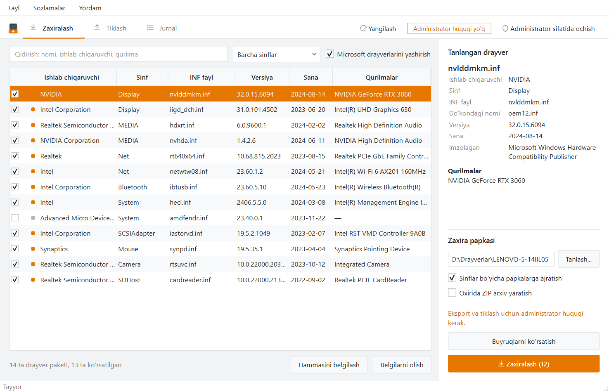
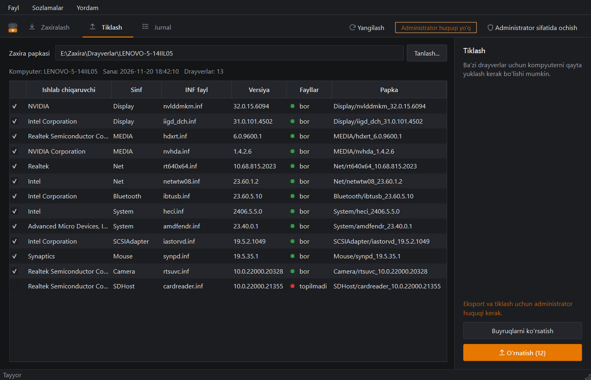
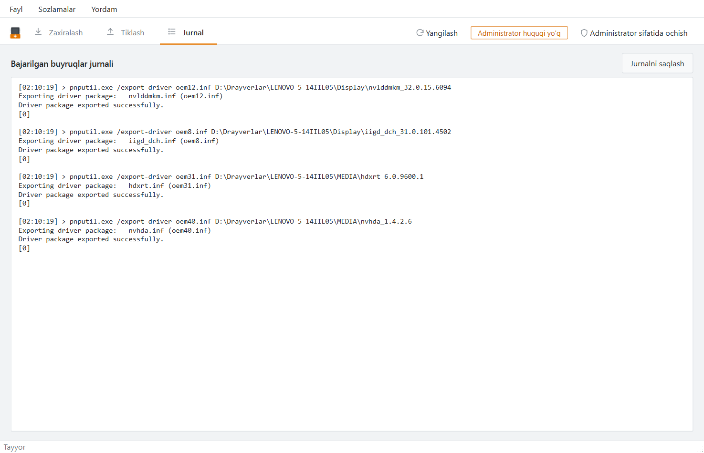

<h1 align="center">Drayver zaxiralovchi</h1>

<b>Driver Backup</b> · Резервное копирование драйверов

   
  
  
  
  

Windows'ni qayta o'rnatishdan oldin uchinchi tomon drayverlarini sinflar bo'yicha papkalarga eksport qiladi, manifest va ZIP arxiv yaratadi, keyin ularni bir bosishda qayta o'rnatadi.

## Imkoniyatlar

- Uchinchi tomon drayver paketlari ro'yxati (pnputil), qaysi qurilmada ishlatilishi (WMI)
- Ishlab chiqaruvchi, sinf, versiya, sana; Microsoft drayverlarini yashirish va qidiruv
- Tanlanganlarni sinflar bo'yicha papkalarga eksport (pnputil /export-driver)
- drivers_manifest.json: kompyuter, sana va har bir drayver ma'lumoti
- ZIP arxiv yaratish
- Tiklash: zaxira papkasidan pnputil /add-driver /subdirs /install
- Buyruqlarni oldindan ko'rish va .bat fayl sifatida saqlash
- Administrator huquqini tekshirish va qayta ishga tushirish
- O'zbek, rus, ingliz tillari; yorug' va qorong'i mavzu

## O'rnatish

1. [**DrayverZaxira.exe**](https://github.com/eduhakimov/drayver-zaxira/releases/latest/download/DrayverZaxira.exe) faylini yuklab oling.
2. Faylni ishga tushiring — o'rnatish shart emas.
3. Windows SmartScreen ogohlantirsa: **Batafsil → Baribir ishga tushirish**.

**Tizim talablari:** Windows 10 (1809+) / Windows 11, x64

---

## Русский

Перед переустановкой Windows экспортирует сторонние драйверы по папкам классов, создаёт манифест и ZIP-архив, а затем восстанавливает их одним нажатием.

- Список сторонних пакетов драйверов (pnputil) и устройств, которые их используют (WMI)
- Поставщик, класс, версия, дата; скрытие драйверов Microsoft и поиск
- Экспорт выбранных по папкам классов (pnputil /export-driver)
- drivers_manifest.json: компьютер, дата и данные каждого драйвера
- Создание ZIP-архива
- Восстановление из папки: pnputil /add-driver /subdirs /install
- Предпросмотр команд и сохранение в .bat
- Проверка прав администратора и перезапуск
- Узбекский, русский, английский; светлая и тёмная тема

## English

Before reinstalling Windows, exports third-party drivers into class folders with a manifest and ZIP archive, then reinstalls them in one click.

- Third-party driver packages (pnputil) and the devices that use them (WMI)
- Provider, class, version, date; hide Microsoft drivers, search
- Export selected drivers into class folders (pnputil /export-driver)
- drivers_manifest.json with computer, date and per-driver details
- ZIP archive creation
- Restore from a backup folder: pnputil /add-driver /subdirs /install
- Preview commands and save them as a .bat file
- Administrator rights check and restart
- Uzbek, Russian and English interface; light and dark themes

---

## Muallif / Author

**Bahtiyorjon Hakimov** (Hakimov Bahtiyorjon Muzaffar o'g'li) — [github.com/eduhakimov](https://github.com/eduhakimov)

© 2026 Bahtiyorjon Hakimov. Barcha huquqlar himoyalangan. / Все права защищены. / All rights reserved.
Batafsil: [LICENSE](LICENSE) · Uchinchi tomon komponentlari: [THIRD_PARTY_NOTICES.md](THIRD_PARTY_NOTICES.md)
