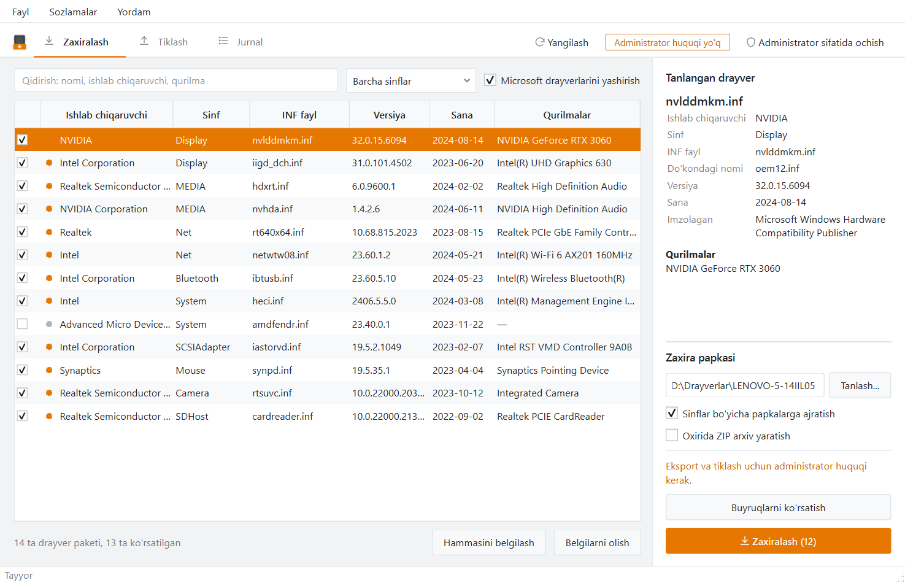
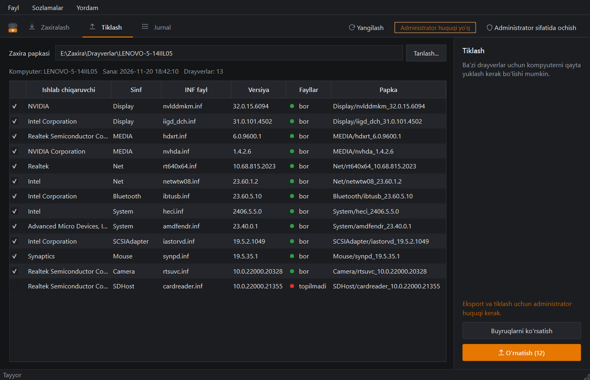
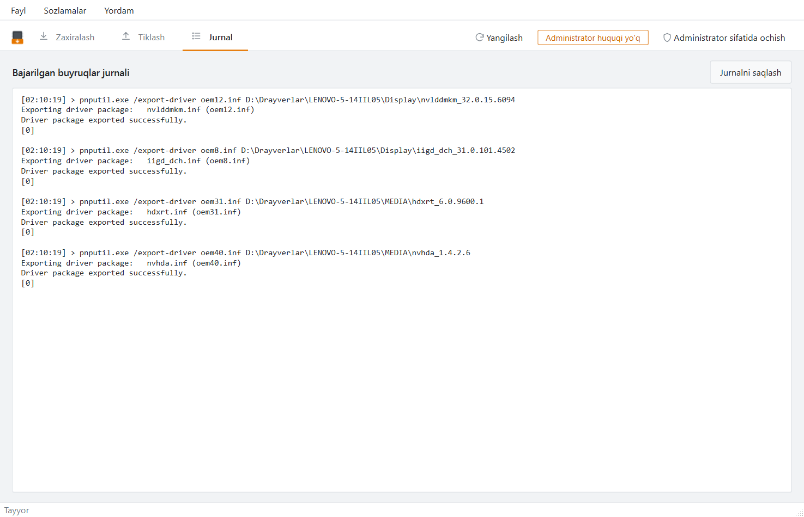

# Drayver zaxiralovchi: Foydalanish qo‘llanmasi

Muallif: Hakimov Bahtiyorjon. Versiya: 1.0.2.

## 1. Umumiy ma’lumot

“Drayver zaxiralovchi” Windows’ni qayta o‘rnatishdan oldin kompyuterdagi uchinchi tomon drayverlarini saqlab qo‘yish va qayta o‘rnatishdan keyin ularni tiklash uchun mo‘ljallangan dastur. U videokarta, tovush, tarmoq, Bluetooth, sensorli panel, kamera, kartalarni o‘qish qurilmasi va boshqa uskunalar drayverlarini ro‘yxat ko‘rinishida ko‘rsatadi, tanlanganlarini papkalarga eksport qiladi va zaxira haqida manifest faylini yaratadi. Keyinchalik shu zaxira papkasidan drayverlar bir tugma bilan qayta o‘rnatiladi.

Dastur kompyuter ustalari, tashkilotlardagi axborot texnologiyalari mutaxassislari, o‘quv muassasalarining laborantlari hamda o‘z kompyuterini mustaqil qayta o‘rnatadigan foydalanuvchilar uchun mo‘ljallangan. Dastur drayverlarni internetdan qidirmaydi va yuklab olmaydi: u faqat shu kompyuterda allaqachon o‘rnatilgan drayver paketlari bilan ishlaydi.

Dastur bilan ishlashning umumiy tartibi uch bosqichdan iborat: Windows qayta o‘rnatilishidan oldin “Zaxiralash” sahifasida drayverlarni fleshkaga eksport qilish; Windows’ni qayta o‘rnatish; so‘ngra “Tiklash” sahifasida shu zaxira papkasini tanlab, drayverlarni qayta o‘rnatish. Har bir bajarilgan buyruq “Jurnal” sahifasida qayd etiladi. Dastur oynasi uchta tildan birida (o‘zbek, rus, ingliz) va yorug‘ yoki qorong‘i mavzuda ishlaydi.

## 2. Tizim talablari

- Operatsion tizim: Windows 10 (1809 va undan keyingi versiya) yoki Windows 11, 64 bitli (x64).
- Internet ulanishi talab qilinmaydi, dastur to‘liq oflayn ishlaydi.
- Drayverlar ro‘yxatini ko‘rish uchun oddiy foydalanuvchi huquqi yetarli; eksport (zaxiralash) va tiklash uchun administrator huquqi kerak.
- Zaxira uchun diskda yoki tashqi tashuvchida (fleshka, tashqi disk) yetarli bo‘sh joy bo‘lishi lozim. Kerakli hajm drayverlar soni va turiga bog‘liq; videokarta drayverlari odatda eng katta hajmni egallaydi.
- Dastur o‘rnatishni talab qilmaydi, bitta .exe fayldan ishga tushadi.

## 3. O‘rnatish va ishga tushirish

1. Dasturning GitHub sahifasidagi Releases bo‘limidan DrayverZaxira.exe faylini yuklab oling (https://github.com/eduhakimov/drayver-zaxira).
2. Faylni qulay papkaga, masalan, fleshkaga joylashtiring. Dasturni fleshkadan ishga tushirish qulay, chunki u Windows qayta o‘rnatilgandan keyin ham kerak bo‘ladi.
3. Faylni ikki marta bosib ishga tushiring. Birinchi ishga tushirishda Windows SmartScreen “Windows kompyuteringizni himoya qildi” ogohlantirishini chiqarishi mumkin. Bu holda “Batafsil” havolasini bosing va “Baribir ishga tushirish” tugmasini tanlang.
4. Dastur oynasi ochilgach, drayverlar ro‘yxati avtomatik o‘qiladi. Holat satrida “Drayverlar ro‘yxati o‘qilmoqda...” yozuvi chiqadi, so‘ngra jadval to‘ladi.
5. Zaxiralash yoki tiklashni bajarish uchun yuqori paneldagi “Administrator sifatida ochish” tugmasini bosing va Windows so‘ragan UAC oynasida ruxsat bering. Dastur administrator huquqi bilan qayta ochiladi. Muqobil ravishda .exe faylni sichqonchaning o‘ng tugmasi bilan bosib, kontekst menyusidan administrator sifatida ishga tushirish bandini tanlash mumkin.

## 4. Dastur oynasi bilan tanishish

Oynaning eng yuqorisida “Fayl”, “Sozlamalar” va “Yordam” menyulari joylashgan. “Fayl” menyusida “Chiqish” bandi (Ctrl+Q), “Sozlamalar” menyusida “Til” va “Mavzu” bandlari, “Yordam” menyusida “Qo‘llanma” (F1) va “Dastur haqida” bandlari bor.

Menyular ostida yorliqlar paneli joylashgan: “Zaxiralash”, “Tiklash” va “Jurnal”. Panelning o‘ng tomonida “Yangilash” tugmasi (drayverlar ro‘yxatini qayta o‘qiydi), administrator huquqi holati belgisi (“Administrator huquqi bor” yoki “Administrator huquqi yo‘q”) va huquq yo‘q bo‘lganda “Administrator sifatida ochish” tugmasi ko‘rinadi.

“Zaxiralash” sahifasining chap qismida qidiruv maydoni, sinflar ro‘yxati (“Barcha sinflar”), “Microsoft drayverlarini yashirish” belgisi va drayverlar jadvali joylashgan. Jadval ustunlari: belgilash katakchasi, “Ishlab chiqaruvchi”, “Sinf”, “INF fayl”, “Versiya”, “Sana”, “Qurilmalar”. Ishlab chiqaruvchi oldidagi to‘q sariq nuqta drayver hozir biror qurilmada ishlatilayotganini, kulrang nuqta esa ishlatilmayotganini bildiradi. Jadval ostida paketlar soni va “Hammasini belgilash”, “Belgilarni olish” tugmalari joylashgan.

O‘ng panelda “Tanlangan drayver” bo‘limi (joriy qator tafsilotlari: ishlab chiqaruvchi, sinf, INF fayl, do‘kondagi nomi, versiya, sana, imzolagan, qurilmalar), “Zaxira papkasi” maydoni va “Tanlash...” tugmasi, “Sinflar bo‘yicha papkalarga ajratish” va “Oxirida ZIP arxiv yaratish” belgilari, “Buyruqlarni ko‘rsatish” va “Zaxiralash (N)” tugmalari joylashgan. Administrator huquqi bo‘lmasa, “Eksport va tiklash uchun administrator huquqi kerak.” degan ogohlantirish ko‘rsatiladi.

“Tiklash” sahifasida “Zaxira papkasi” maydoni, zaxira haqida ma’lumot satri, drayverlar jadvali (“Ishlab chiqaruvchi”, “Sinf”, “INF fayl”, “Versiya”, “Fayllar”, “Papka”) hamda o‘ng panelda “Buyruqlarni ko‘rsatish” va “O‘rnatish (N)” tugmalari bor. “Jurnal” sahifasida bajarilgan buyruqlar matni va “Jurnalni saqlash” tugmasi joylashgan. Oynaning eng pastida holat satri bor.

*1-rasm. Asosiy oyna, “Zaxiralash” sahifasi: drayverlar jadvali, o‘ng panelda tanlangan drayver tafsilotlari va zaxira sozlamalari*

*2-rasm. “Tiklash” sahifasi qorong‘i mavzuda: zaxira papkasi, manifest ma’lumoti va “O‘rnatish (12)” tugmasi*

*3-rasm. “Jurnal” sahifasi: eksport buyruqlari va ularning natijalari*

## 5. Asosiy amallar

**Drayverlarni zaxiralash**

1. Dasturni administrator sifatida ishga tushiring va “Zaxiralash” yorlig‘ini oching.
2. Ro‘yxat to‘lishini kuting. Zarur bo‘lsa, “Yangilash” tugmasi bilan ro‘yxatni qayta o‘qing.
3. Keraksiz drayverlarni olib tashlash uchun qidiruv maydoni yoki sinflar ro‘yxatidan foydalaning. “Microsoft drayverlarini yashirish” belgisi standart holatda yoqilgan; Windows bilan birga keladigan drayverlarni zaxiralash odatda shart emas.
4. Zaxiraga kiritiladigan drayverlarni katakchalar bilan belgilang yoki “Hammasini belgilash” tugmasini bosing. E’tibor bering: belgilash tugmalari va eksport faqat ekranda ko‘rinib turgan qatorlarga taalluqli. Tugmadagi raqam, masalan, “Zaxiralash (12)” zaxiraga kiradigan drayverlar sonini ko‘rsatadi.
5. “Zaxira papkasi” maydonida “Tanlash...” tugmasi orqali saqlash joyini tanlang. Fleshkani tanlash tavsiya etiladi, chunki tizim diski qayta o‘rnatishda formatlanishi mumkin. Agar diskning o‘zini (masalan, E:\) tanlasangiz, dastur uning ichida Drayverlar papkasini va kompyuter nomidagi papkani avtomatik yaratadi.
6. “Sinflar bo‘yicha papkalarga ajratish” belgisini qoldiring: drayverlar Display, Net, MEDIA kabi sinf papkalariga joylashadi. Arxiv kerak bo‘lsa, “Oxirida ZIP arxiv yaratish” belgisini yoqing.
7. Ixtiyoriy ravishda “Buyruqlarni ko‘rsatish” tugmasi orqali bajariladigan buyruqlarni ko‘rib chiqing.
8. “Zaxiralash (N)” tugmasini bosing. Dastur nechta drayver qaysi papkaga eksport qilinishini ko‘rsatib, tasdiq so‘raydi. “Ha” tugmasini bosing.
9. Jarayon tugagach, nechta drayver zaxiralangani, nechtasida xato bo‘lgani va manifest fayli nomi haqida xabar chiqadi, zaxira papkasi Explorer’da ochiladi. ZIP arxiv tanlangan bo‘lsa, u zaxira papkasi yonida shu papka nomi bilan yaratiladi.
**Drayverlarni tiklash**

1. Windows qayta o‘rnatilgandan so‘ng dasturni administrator sifatida ishga tushiring va “Tiklash” yorlig‘ini oching.
2. “Zaxira papkasi” maydonida “Tanlash...” tugmasi bilan avval yaratilgan zaxira papkasini (kompyuter nomi bilan atalgan papkani) tanlang yoki papkani oynaga sudrab tashlang. ZIP arxivdan foydalanilgan bo‘lsa, avval uni papkaga chiqarib oling.
3. Manifest topilsa, ma’lumot satrida kompyuter nomi, zaxira sanasi va drayverlar soni chiqadi. Manifest bo‘lmasa, dastur .inf fayl bor papkalarni qidirib topadi va ularning sonini xabar qiladi.
4. “Fayllar” ustunini tekshiring: yashil belgi papka mavjudligini, qizil belgi esa papka topilmaganini bildiradi. Papkasi topilmagan drayverlar tiklashga kiritilmaydi.
5. O‘rnatilishi kerak bo‘lmagan drayverlar belgisini olib tashlang.
6. “O‘rnatish (N)” tugmasini bosing va tasdiqlash oynasida “Ha” ni tanlang. Drayverlar tizimga qo‘shiladi va mos qurilmalarga o‘rnatiladi.
7. Yakuniy xabarda muvaffaqiyatli va xato bilan tugagan amallar soni ko‘rsatiladi. Ayrim drayverlar uchun kompyuterni qayta yuklash kerak bo‘lishi mumkin.
**Buyruqlarni .bat fayl sifatida saqlash**

1. “Zaxiralash” yoki “Tiklash” sahifasida drayverlarni belgilang.
2. “Buyruqlarni ko‘rsatish” tugmasini bosing. “Bajariladigan buyruqlar” oynasi ochiladi.
3. “Nusxalash” tugmasi buyruqlarni buferga ko‘chiradi, “.bat saqlash” tugmasi ularni buyruq fayli sifatida saqlaydi, “Yopish” oynani yopadi. Saqlangan .bat faylni administrator sifatida ishga tushirish kerak.
**Jurnal bilan ishlash**

1. “Jurnal” yorlig‘ini oching. Har bir buyruq vaqt, chiqish matni va qavs ichidagi qaytish kodi bilan ko‘rsatiladi; [0] kodi muvaffaqiyatni bildiradi.
2. “Jurnalni saqlash” tugmasini bosib, jurnalni matn fayli sifatida saqlang. Bu fayl muammolarni tahlil qilishda foydali.

*4-rasm. Zaxiralashga tayyor holat: 12 ta drayver belgilangan, zaxira papkasi D:\Drayverlar\LENOVO-5-14IIL05*

## 6. Sozlamalar

- **Til.** “Sozlamalar” menyusidagi “Til” bandidan O‘zbekcha, Русский yoki English tanlanadi. Tilni o‘zgartirish uchun dastur qayta ishga tushirilishi haqida so‘raydi, tasdiqlangandan keyin yangi tilda ochiladi.
- **Mavzu.** “Mavzu” bandidan “Tizim bo‘yicha”, “Yorug‘” yoki “Qorong‘i” tanlanadi. Mavzu darhol qo‘llanadi.
- **Zaxira papkasi.** Zaxiralashdan keyin tanlangan papkaning ota papkasi eslab qolinadi; keyingi safar unga avtomatik ravishda joriy kompyuter nomi qo‘shiladi. Bu bir fleshkada bir nechta kompyuter zaxirasini alohida papkalarda saqlashga qulay.
- **Oyna o‘lchami** dastur yopilganda saqlanadi va keyingi ishga tushirishda tiklanadi.

## 7. Ma’lumotlarni saqlash va xavfsizlik

Dastur sozlamalari foydalanuvchi profilidagi %APPDATA%\BahtiyorSoft\drayver-zaxira papkasida JSON faylda saqlanadi. Shu papkada kutilmagan xatoliklar yoziladigan texnik jurnal fayli ham joylashadi.

Zaxira faqat foydalanuvchi tanlagan papkaga yoziladi. Unda har bir drayver uchun alohida papka va manifest fayli (JSON) bo‘ladi. Manifestga kompyuter nomi, zaxira sanasi, Windows versiyasi va har bir drayver haqidagi ma’lumotlar yoziladi. Faqat muvaffaqiyatli eksport qilingan drayverlar manifestga tushadi.

Zaxira papkasining tuzilishi quyidagicha: kompyuter nomidagi asosiy papka ichida sinf papkalari (masalan, Display, MEDIA, Net, Bluetooth, System), ularning ichida esa har bir drayver uchun INF fayl nomi va versiyadan tuzilgan alohida papka joylashadi. Manifest fayli asosiy papkaning o‘zida turadi. ZIP arxiv tanlangan bo‘lsa, u asosiy papka yonida yaratiladi. Bu tuzilmani boshqa joyga ko‘chirish mumkin, faqat ichki papkalar tarkibini o‘zgartirmaslik kerak.

Drayverlar ro‘yxatini ko‘rish tizimni o‘zgartirmaydi. Eksport drayver ombori tarkibini o‘zgartirmaydi, faqat nusxa oladi. Tiklash esa tizimga drayver qo‘shadi va qurilmalarga o‘rnatadi, shuning uchun u administrator huquqi va tasdiq bilan bajariladi. Dastur drayverlarni o‘chirmaydi va internetga hech qanday ma’lumot yubormaydi.

Xavfsizlik bo‘yicha tavsiyalar: faqat o‘zingiz yaratgan yoki ishonchli manbadan olingan zaxira papkasidan tiklang; boshqa kompyuter modelining zaxirasini o‘rnatishdan oldin jadvaldagi drayverlarni ko‘rib chiqing; tiklashdan oldin “Buyruqlarni ko‘rsatish” orqali bajariladigan amallarni tekshiring.

## 8. Ko‘p uchraydigan savollar va muammolar

**“Zaxiralash” tugmasini bossam, administrator huquqi haqida xabar chiqadi.** Eksport va tiklash administrator huquqini talab qiladi. Xabardagi savolga “Ha” deb javob bersangiz, dastur administrator sifatida qayta ishga tushadi; UAC oynasida ruxsat bering.

**Ro‘yxatda ba’zi drayverlar ko‘rinmayapti.** “Microsoft drayverlarini yashirish” belgisi yoqilgan, qidiruv maydonida matn bor yoki sinflar ro‘yxatida bitta sinf tanlangan bo‘lishi mumkin. Filtrlarni tozalang. Dastur faqat drayver omboriga oemNN.inf nomi bilan qo‘shilgan paketlarni ko‘rsatadi.

**“Qurilmalar” ustunida chiziqcha turibdi.** Bu drayver hozir hech bir ulangan qurilmada ishlatilmayotganini bildiradi. Bunday drayverni zaxiralash shart emas, lekin keyinchalik ulanadigan qurilma uchun kerak bo‘lsa, belgilab qo‘yish mumkin.

**Zaxiralashda ba’zi drayverlar xato bilan tugadi.** “Jurnal” sahifasida tegishli buyruq chiqishi va kodini ko‘ring. Xato bilan tugagan drayverlar manifestga yozilmaydi va ularning bo‘sh papkalari o‘chiriladi.

**Tiklash sahifasida “Fayllar” ustunida qizil belgi bor.** Manifestda ko‘rsatilgan papka diskda topilmadi. Zaxira papkasi to‘liq ko‘chirilganini tekshiring.

**Manifest yo‘q papkadan tiklash mumkinmi?** Ha. Dastur .inf fayllar bor ichki papkalarni topadi va ularni ro‘yxatga chiqaradi.

**Tiklashdan keyin qurilma hali ham ishlamayapti.** Kompyuterni qayta yuklang. Agar qurilma boshqa model bo‘lsa, zaxiradagi drayver unga mos kelmasligi mumkin.

**ZIP arxivdan to‘g‘ridan-to‘g‘ri tiklash mumkinmi?** Yo‘q, avval arxivni papkaga chiqarib, shu papkani tanlang.

**Bitta fleshkada bir nechta kompyuter zaxirasini saqlash mumkinmi?** Ha. Dastur zaxira papkasiga avtomatik ravishda kompyuter nomini qo‘shadi, shuning uchun har bir kompyuter zaxirasi alohida papkada saqlanadi. Tiklashda aynan kerakli kompyuter nomidagi papkani tanlang.

**Jarayon davomida tugmalar bosilmayapti.** Eksport, tiklash yoki ro‘yxatni o‘qish bajarilayotganda “Zaxiralash”, “O‘rnatish” va “Yangilash” tugmalari vaqtincha faolsizlantiriladi. Jarayon chizig‘i yo‘qolguncha kuting, holat satrida joriy amal ko‘rsatiladi.

**Tilni o‘zgartirsam, dastur yopilib qoldi.** Bu kutilgan holat: til tanlangach dastur tasdiq so‘raydi va yangi tilda qayta ishga tushadi.

**Saqlangan .bat fayl ishlamayapti.** Fayl ichidagi buyruqlar administrator huquqini talab qiladi. Faylni sichqonchaning o‘ng tugmasi bilan bosib, administrator sifatida ishga tushiring.

