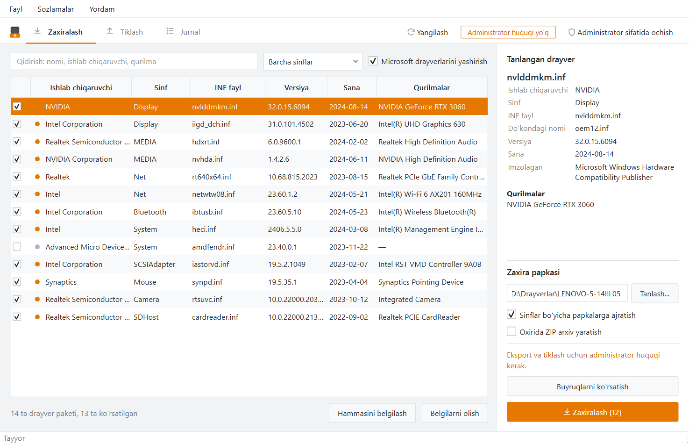
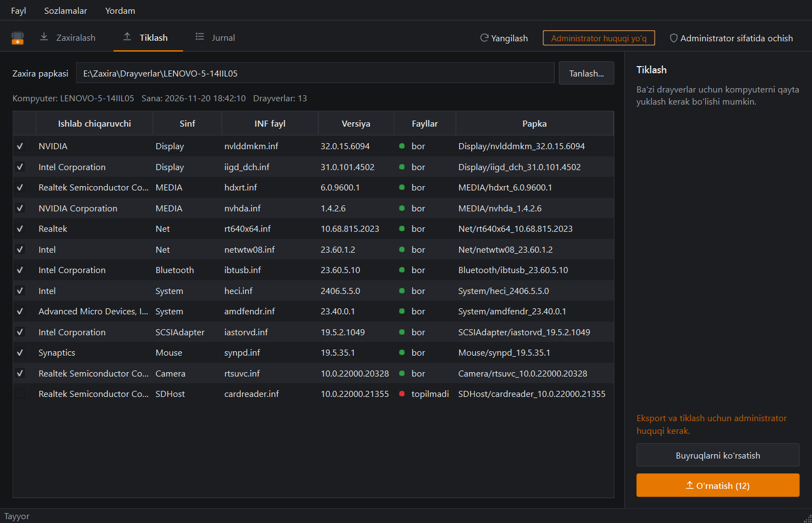
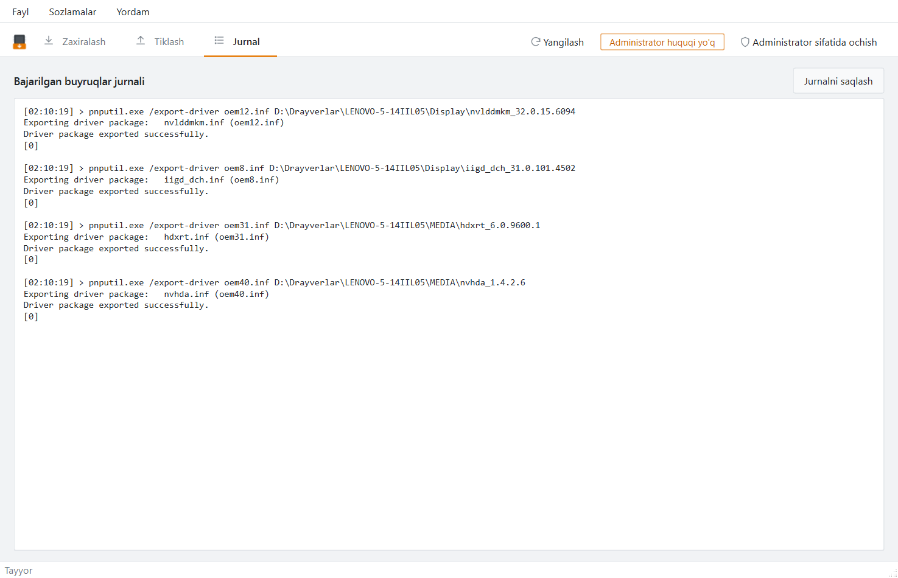

UDK: 004.451

# Windows operatsion tizimida uchinchi tomon drayver paketlarini zaxiralash va tiklash uchun dasturiy vosita: arxitektura va amalga oshirish

**Hakimov Bahtiyorjon**  
*[ish joyi, lavozimi, elektron pochta]*

**Annotatsiya.** Maqolada Windows operatsion tizimini qayta o‘rnatishdan oldin uchinchi tomon drayver paketlarini saqlab qo‘yish va keyin ularni qayta o‘rnatish vazifasini avtomatlashtiruvchi “Drayver zaxiralovchi” dasturi tavsiflanadi. Dastur tizimning drayver omboridagi paketlar ro‘yxatini PnPUtil vositasi orqali o‘qiydi, ularni WMI yordamida qurilmalar bilan bog‘laydi, tanlangan paketlarni sinflar bo‘yicha papkalarga eksport qiladi, JSON formatidagi manifest va ixtiyoriy ZIP arxiv yaratadi. Tiklash bosqichida zaxira papkasi manifest yoki INF fayllar bo‘yicha tahlil qilinib, paketlar tizimga qo‘shiladi va mos qurilmalarga o‘rnatiladi. Python 3.12 va PySide6 asosidagi arxitektura, administrator huquqini tekshirish, buyruqlarni oldindan ko‘rish va sinov natijalari yoritiladi.

*Kalit so‘zlar:* drayver paketi, zaxira nusxa, PnPUtil, drayver ombori, WMI, Windows, manifest, PySide6.

**Программное средство резервного копирования и восстановления сторонних пакетов драйверов в операционной системе Windows: архитектура и реализация**

**Аннотация.** В статье описывается программа «Drayver zaxiralovchi», автоматизирующая сохранение сторонних пакетов драйверов перед переустановкой Windows и их последующую повторную установку. Программа считывает список пакетов из хранилища драйверов с помощью утилиты PnPUtil, сопоставляет их с устройствами через WMI, экспортирует выбранные пакеты в папки по классам устройств, создаёт манифест в формате JSON и, при необходимости, ZIP-архив. На этапе восстановления папка с копией анализируется по манифесту или по INF-файлам, после чего пакеты добавляются в систему и устанавливаются на подходящие устройства. Рассматриваются архитектура на Python 3.12 и PySide6, проверка прав администратора, предварительный просмотр команд и результаты тестирования.

*Ключевые слова:* пакет драйвера, резервная копия, PnPUtil, хранилище драйверов, WMI, Windows, манифест, PySide6.

**A software tool for backing up and restoring third-party driver packages in Windows: architecture and implementation**

**Abstract.** The paper describes “Drayver zaxiralovchi” (Driver Backup), a program that automates saving third-party driver packages before Windows is reinstalled and installing them again afterwards. The program reads the list of packages in the driver store with the PnPUtil utility, links them to devices through WMI, exports the selected packages into folders grouped by device class, and writes a JSON manifest and, optionally, a ZIP archive. During restoration the backup folder is analysed using the manifest or the INF files it contains, and the packages are added to the system and installed on matching devices. The architecture based on Python 3.12 and PySide6, the administrator rights check, command preview and the test results are discussed.

*Keywords:* driver package, backup, PnPUtil, driver store, WMI, Windows, manifest, PySide6.

## Kirish

Tashkilotlar, ta’lim muassasalari va kompyuter servis xizmatlarida operatsion tizimni qayta o‘rnatish muntazam bajariladigan ishlardan biridir. Windows qayta o‘rnatilgandan so‘ng tizim tarkibidagi standart drayverlar ko‘plab qurilmalarni ishga tushiradi, biroq videokarta, tovush kartasi, simsiz tarmoq adapteri, Bluetooth moduli, sensorli panel, kartalarni o‘qish qurilmasi yoki disk kontrolleri kabi uskunalar ko‘pincha ishlab chiqaruvchining o‘z drayverini talab qiladi. Bunday drayverlarni qayta topish uchun internetga ulanish, ishlab chiqaruvchi saytida aynan shu model uchun mos versiyani izlash zarur bo‘ladi. Tarmoq adapterining o‘zi drayversiz qolgan holatda esa internetga chiqishning imkoni bo‘lmaydi va muammo yanada murakkablashadi.

Yechimlardan biri tizimni qayta o‘rnatishdan oldin hozirgi kompyuterda ishlab turgan uchinchi tomon drayver paketlarini alohida tashuvchiga saqlab qo‘yishdir. Windows bu imkoniyatni o‘zining PnPUtil buyruq qatori vositasi orqali taqdim etadi, lekin bu vosita bilan ishlash buyruqlar sintaksisini bilishni, har bir paketning ombordagi nomini aniqlashni va natijalarni qo‘lda tartibga solishni talab qiladi. Oddiy foydalanuvchi va hatto tajribali usta uchun ham bir necha o‘nlab paketlarni birma-bir eksport qilish va keyin qaysi papkada qaysi qurilma drayveri turganini eslab qolish noqulay.

Raqamlashtirish jarayonida kompyuter parkiga xizmat ko‘rsatish samaradorligi muhim ahamiyatga ega. O‘zbekiston Respublikasi Prezidentining “Raqamli O‘zbekiston – 2030” strategiyasi to‘g‘risidagi Farmonida axborot-kommunikatsiya infratuzilmasini rivojlantirish va raqamli ko‘nikmalarni oshirish vazifalari belgilangan. Kompyuterlarni texnik qo‘llab-quvvatlashning takrorlanuvchi amallarini xavfsiz va tushunarli dasturiy vositalar bilan avtomatlashtirish shu vazifalarning amaliy tarkibiy qismidir.

Ushbu maqolada muallif tomonidan ishlab chiqilgan “Drayver zaxiralovchi” dasturi tavsiflanadi. Dastur uchinchi tomon drayver paketlari ro‘yxatini ko‘rsatadi, ularni qurilmalar bilan bog‘laydi, tanlanganlarini sinflar bo‘yicha tartiblangan papkalarga eksport qiladi, zaxiraning tavsifi sifatida manifest faylini yozadi va keyinchalik shu zaxiradan drayverlarni bir buyruq bilan qayta o‘rnatishga imkon beradi. Maqolaning maqsadi dasturning arxitekturasi, ishlash tamoyillari, xavfsizlik choralari va sinov natijalarini ilmiy-texnik nuqtai nazardan yoritishdan iborat.

## Muammoning qo‘yilishi va mavjud yechimlar tahlili

Windows operatsion tizimida drayverlar paket shaklida drayver omboriga (Driver Store) joylashtiriladi. Har bir paket INF tavsif faylidan, katalog (imzo) faylidan va drayverning ikkilik fayllaridan iborat. Paket omborga qo‘shilganda unga oemNN.inf ko‘rinishidagi nom beriladi, asl INF faylining nomi esa alohida saqlanadi. Shu sababli bitta paketni aniqlash uchun ikki nom mavjud bo‘ladi: ombordagi nom va asl nom. Foydalanuvchi uchun esa qurilma nomi, ya’ni “bu drayver qaysi uskunaga tegishli” degan savolga javob muhimroq.

Vazifani quyidagicha shakllantirish mumkin: kompyuterda o‘rnatilgan uchinchi tomon drayver paketlarini aniqlash, ularni foydalanuvchiga tushunarli shaklda (ishlab chiqaruvchi, qurilma sinfi, versiya, sana, foydalanuvchi qurilmalar) ko‘rsatish, foydalanuvchi tanlagan paketlarni tartibli papkalar tuzilmasiga eksport qilish, zaxiraning tarkibini mashina o‘qiy oladigan formatda qayd etish va zaxiradan qayta o‘rnatishni ishonchli bajarish. Bunda tizim holatini o‘zgartiruvchi har qanday amal administrator huquqini talab qilishi, foydalanuvchi esa bajariladigan buyruqlarni oldindan ko‘ra olishi kerak.

Amaldagi yechimlarni bir necha turga ajratish mumkin. Birinchi tur operatsion tizimning o‘rnatilgan buyruq qatori vositalari: PnPUtil va DISM. Ular ishonchli va qo‘shimcha o‘rnatishni talab qilmaydi, lekin grafik interfeysga ega emas, natijani qurilmalar bilan bog‘lamaydi va papkalarni foydalanuvchi uchun tartiblamaydi. Ikkinchi tur drayverlarni yangilash va zaxiralash bo‘yicha tijorat yoki bepul uchinchi tomon dasturlari. Ularning imkoniyatlari turlicha bo‘lib, ayrimlari internetdagi drayver bazasiga tayanadi, ayrimlari qo‘shimcha xizmatlarni taklif qiladi; bunday dasturni tanlashda foydalanuvchi uning qaysi amallarni bajarishini oldindan bilishi muhim. Uchinchi tur qo‘lda bajariladigan usul: foydalanuvchi ishlab chiqaruvchi saytidan drayverlarni oldindan yuklab olib, tashuvchida saqlaydi. Bu usul vaqt talab etadi va kompyuterda haqiqatda ishlayotgan versiyani emas, saytdagi mavjud versiyani saqlaydi.

Mazkur ishda tanlangan yondashuv birinchi turdagi vositalarning ishonchliligini saqlab qolgan holda ularning ustiga grafik interfeys, qurilmalar bilan bog‘lash, sinflar bo‘yicha tartiblash, manifest va oldindan ko‘rish qatlamini qo‘shishdan iborat. Dastur drayverlarni internetdan yuklamaydi va o‘z bazasiga ega emas: u faqat shu kompyuterning drayver omborida mavjud bo‘lgan paketlar bilan ishlaydi. Bu yondashuv natijaning oldindan aytib berilishini ta’minlaydi, chunki eksport qilingan paket aynan hozir tizimda o‘rnatilgan paketning nusxasidir.

## Tadqiqot metodologiyasi va dasturiy arxitektura

Dastur Python 3.12 dasturlash tilida yozilgan, grafik interfeys Qt 6 kutubxonasining Python uchun rasmiy bog‘lamasi bo‘lgan PySide6 yordamida qurilgan. Qurilmalar haqidagi ma’lumotlarni olish uchun pywin32 to‘plami va WMI kutubxonasi ishlatiladi. Dastur PyInstaller yordamida bitta bajariladigan .exe faylga yig‘iladi va o‘rnatishni talab qilmaydi. Ishlatilgan uchinchi tomon komponentlari va ularning litsenziyalari dastur bilan birga keladigan THIRD PARTY NOTICES hujjatida keltirilgan.

Arxitektura ikki asosiy qatlamga bo‘lingan. Birinchi qatlam drayverlar bilan ishlash mantiqini o‘z ichiga olgan modul bo‘lib, u grafik interfeysga bog‘liq emas. Bu modulda drayver paketining ma’lumotlar tuzilmasi, PnPUtil chiqishini tahlil qilish, versiya va sanani ajratish, eksport va tiklash rejalarini tuzish, manifestni yozish va o‘qish, zaxira papkasini tahlil qilish, ZIP arxiv yaratish va buyruqlarni bajarish funksiyalari joylashgan. Muhim tamoyil shundaki, buyruqlarni tuzish va ularni bajarish alohida funksiyalarga ajratilgan: reja avval ma’lumotlar sifatida shakllantiriladi, keyin esa alohida bajaruvchi funksiyaga uzatiladi. Bu bir tomondan foydalanuvchiga buyruqlarni oldindan ko‘rsatishga, ikkinchi tomondan testlarda tizim buyruqlarini haqiqatda chaqirmasdan mantiqni tekshirishga imkon beradi.

Ikkinchi qatlam grafik interfeys bo‘lib, u uchta sahifadan iborat: “Zaxiralash”, “Tiklash” va “Jurnal”. Sahifalar yuqoridagi yorliqlar paneli orqali almashtiriladi. Panelda shuningdek “Yangilash” tugmasi, administrator huquqi holatini ko‘rsatuvchi belgi va huquq bo‘lmaganda “Administrator sifatida ochish” tugmasi joylashgan. Uzoq davom etadigan amallar (ro‘yxatni o‘qish, eksport, tiklash, arxivlash) alohida ishchi oqimda bajariladi, interfeys esa jarayon chizig‘i va holat satri orqali bajarilish holatini ko‘rsatadi. Bir vaqtning o‘zida faqat bitta ish bajarilishi mumkin: ish davomida asosiy tugmalar va “Yangilash” tugmasi faolsizlantiriladi.

Ma’lumot oqimi quyidagicha tashkil etilgan. Dastur ishga tushganda “pnputil /enum-drivers” buyrug‘ini bajaradi va uning matnli chiqishini tahlil qiladi. Chiqish bloklarga bo‘linadi, har bir blokdan ombordagi nom, asl nom, ishlab chiqaruvchi, sinf nomi, sinf identifikatori, versiya va imzolovchi ajratib olinadi. Ingliz tilidagi chiqishda maydonlar nomi bo‘yicha aniqlanadi; Windows boshqa tilda bo‘lsa va maydon nomlari tarjima qilingan bo‘lsa, maydonlarning doimiy tartibiga tayaniladi, bunda blokning birinchi qiymati oemNN.inf ko‘rinishida ekanligi tekshiriladi. Versiya qatoridagi sana oy, kun, yil tartibidagi va nuqtali mahalliy formatlarda tanib olinadi va yil, oy, kun ko‘rinishiga keltiriladi. Chiqish matni bir necha kodlash usuli bilan navbatma-navbat dekodlanadi.

Keyingi bosqichda WMI xizmatining imzolangan Plug and Play drayverlari haqidagi sinfidan har bir oemNN.inf paketidan foydalanayotgan qurilmalar nomlari olinadi va paketlarga biriktiriladi. Ro‘yxat sinf, ishlab chiqaruvchi va asl nom bo‘yicha saralanadi. Ishlab chiqaruvchi nomida “Microsoft” so‘zi uchraydigan paketlar alohida belgilanadi va standart holatda ro‘yxatda yashiriladi.

Eksport rejasi har bir tanlangan paket uchun manzil papkasini va “pnputil /export-driver” buyrug‘ini juftlik sifatida tuzadi. Papka nomi asl INF fayl nomi va versiyadan hosil qilinadi, “Sinflar bo‘yicha papkalarga ajratish” belgisi yoqilgan bo‘lsa, paket o‘z sinfi nomidagi papka ichiga joylashtiriladi. Fayl tizimida ruxsat etilmagan belgilar xavfsiz belgiga almashtiriladi. Eksport tugagach, dastur zaxira papkasiga manifest faylini (JSON) yozadi. Manifestda format raqami, yaratilgan sana va vaqt, kompyuter nomi, Windows versiyasi, drayverlar soni va har bir drayver uchun ombordagi nom, asl nom, ishlab chiqaruvchi, sinf, versiya, sana, imzolovchi, qurilmalar ro‘yxati va zaxiradagi nisbiy papka qayd etiladi.

Zaxira papkasini tanlash qoidasi ham arxitekturaning alohida elementi sifatida ishlab chiqilgan. Foydalanuvchi disk ildizini, masalan, fleshkaning o‘zini ko‘rsatsa, dastur yo‘lni avtomatik ravishda disk ildizidagi Drayverlar papkasi va kompyuter nomidagi ichki papka bilan to‘ldiradi. ZIP arxiv yo‘li zaxira papkasi nomidan hosil qilinadi va arxiv shu papka yonida yaratiladi. Buyruq qatorini shakllantirishda bo‘sh joy bor argumentlar qo‘shtirnoqqa olinadi, buyruq faylida esa foiz belgisi ikkilantiriladi. Bu qoidalar avtomatik testlar bilan alohida tekshiriladi.

Oflayn ishlash dasturning asosiy xususiyatlaridan biridir. Dastur internetga murojaat qilmaydi, hech qanday ma’lumotni tashqariga yubormaydi va faqat operatsion tizimning o‘z vositalari (pnputil.exe va WMI) bilan ishlaydi. Foydalanuvchi sozlamalari (til, mavzu, oyna o‘lchami va oxirgi zaxira papkasi) foydalanuvchi profilidagi ilova ma’lumotlari papkasida JSON faylda saqlanadi.

Xavfsizlik choralari koddagi quyidagi mexanizmlarga asoslanadi. Birinchidan, drayverlar ro‘yxatini o‘qish faqat o‘qish amali bo‘lib, tizim holatini o‘zgartirmaydi. Ikkinchidan, eksport va tiklashdan oldin dastur Windows API orqali administrator huquqini tekshiradi; huquq bo‘lmasa, amal bajarilmaydi va foydalanuvchiga dasturni administrator sifatida qayta ishga tushirish taklif qilinadi, bunda Windows foydalanuvchi hisobini boshqarish (UAC) oynasi chiqadi. Uchinchidan, har ikki amal oldidan nechta drayver va qaysi papka ishtirok etishi ko‘rsatilgan tasdiqlash so‘rovi chiqariladi. To‘rtinchidan, “Buyruqlarni ko‘rsatish” tugmasi bajariladigan buyruqlarning to‘liq ro‘yxatini ko‘rsatadi va ularni nusxalash yoki .bat fayl sifatida saqlashga imkon beradi. Beshinchidan, bajarilgan har bir buyruq, uning chiqishi va qaytgan kodi “Jurnal” sahifasiga yoziladi.

Tadqiqot metodologiyasi amaliy muhandislik yondashuviga asoslangan: avval operatsion tizimning drayverlar bilan ishlash vositalari va ularning chiqish formatlari o‘rganildi, so‘ngra ushbu formatlarni tahlil qiluvchi va buyruqlarni tuzuvchi funksiyalar alohida modulga ajratildi. Har bir funksiya uchun kirish va chiqish ma’lumotlari aniq belgilanib, ular tizim buyruqlarini chaqirmaydigan avtomatik testlar bilan tekshirildi. Grafik interfeys esa ushbu modul ustiga qurildi va faqat foydalanuvchi bilan muloqot, holatni ko‘rsatish hamda ishlarni navbatga qo‘yish vazifalarini bajaradi.

## Amalga oshirish va asosiy funksiyalar

**Drayverlar ro‘yxati va tanlash.** “Zaxiralash” sahifasining markaziy qismida drayver paketlari jadvali joylashgan. Ustunlar: belgilash katakchasi, “Ishlab chiqaruvchi”, “Sinf”, “INF fayl”, “Versiya”, “Sana” va “Qurilmalar”. Ishlab chiqaruvchi nomi oldidagi rangli nuqta paketning hozirda biror qurilma tomonidan ishlatilayotganini (to‘q sariq) yoki ishlatilmayotganini (kulrang) bildiradi. Jadval ustida qidiruv maydoni (nomi, ishlab chiqaruvchi, qurilma bo‘yicha), sinflar ro‘yxati va “Microsoft drayverlarini yashirish” belgisi joylashgan. Jadval ostida umumiy va ko‘rsatilgan paketlar soni hamda “Hammasini belgilash” va “Belgilarni olish” tugmalari mavjud. Belgilash tugmalari faqat ko‘rinib turgan qatorlarga ta’sir qiladi, eksportga ham faqat belgilangan va filtrdan o‘tgan paketlar kiradi.

O‘ng paneldagi “Tanlangan drayver” bo‘limida joriy qatordagi paket haqida batafsil ma’lumot chiqadi: ishlab chiqaruvchi, sinf, INF fayl, do‘kondagi (ombordagi) nomi, versiya, sana, imzolagan tashkilot va paketdan foydalanuvchi qurilmalar. Agar paket hech bir qurilmada ishlatilmasa, bu haqda alohida yozuv ko‘rsatiladi. 1-rasmda yorug‘ mavzudagi “Zaxiralash” sahifasi tasvirlangan.

**Eksport.** O‘ng panelning pastki qismida “Zaxira papkasi” maydoni, “Sinflar bo‘yicha papkalarga ajratish” va “Oxirida ZIP arxiv yaratish” belgilari hamda “Zaxiralash (N)” tugmasi joylashgan, bunda N belgilangan paketlar soni. Standart zaxira papkasi foydalanuvchining “Hujjatlar” papkasidagi Drayverlar papkasi ichida kompyuter nomi bilan ataladigan papka; foydalanuvchi boshqa papka tanlasa, uning ota papkasi sozlamalarda eslab qolinadi va keyingi safar kompyuter nomi unga qo‘shiladi. Agar foydalanuvchi disk ildizini (masalan, fleshkaning o‘zini) tanlasa, dastur uning ichida Drayverlar papkasini va kompyuter nomidagi papkani yaratadi. Bu cheklov ZIP arxiv butun diskni qamrab olishining va noto‘g‘ri nomlanishining oldini oladi.

Eksport paytida har bir paket uchun papka oldindan yaratiladi va “pnputil /export-driver” buyrug‘i bajariladi. PnPUtil qaytargan 0 va 3010 (qayta yuklash talab qilinadi) kodlari, shuningdek 259 kodi muvaffaqiyat sifatida qabul qilinadi. Eksport qilinmagan paketlar manifestga yozilmaydi, ular uchun yaratilgan bo‘sh papkalar o‘chiriladi. Natijada manifest faqat haqiqatda saqlangan paketlarni aks ettiradi. Yakunda dastur muvaffaqiyatli va xato bilan tugagan paketlar sonini, manifest fayli nomini va ZIP arxiv yaratilgan bo‘lsa uning yo‘lini xabar qiladi hamda zaxira papkasini Explorer’da ochadi. ZIP arxiv zaxira papkasi yonida, papka nomi bilan yaratiladi.

**Tiklash.** “Tiklash” sahifasida foydalanuvchi avval yaratilgan zaxira papkasini tanlaydi yoki uni oynaga sudrab tashlaydi. Agar papkada manifest bo‘lsa, kompyuter nomi, zaxira sanasi va drayverlar soni ko‘rsatiladi, jadvalga esa manifestdagi yozuvlar chiqariladi va har biri uchun papkaning diskda mavjudligi tekshiriladi. Manifest bo‘lmasa, dastur papkani beshta darajagacha chuqurlikda ko‘rib chiqadi va .inf fayl bor har bir papkani alohida drayver sifatida ro‘yxatga oladi. Shu tariqa boshqa vosita bilan eksport qilingan drayverlar papkasidan ham foydalanish mumkin. Jadvalda “Fayllar” ustuni papka mavjudligini yashil yoki qizil belgi bilan ko‘rsatadi, papkasi yo‘q yozuvlar belgilanmaydi va tiklashga kiritilmaydi (2-rasm).

“O‘rnatish (N)” tugmasi bosilganda har bir tanlangan yozuv uchun “pnputil /add-driver <papka>\*.inf /subdirs /install” buyrug‘i tuziladi. Bu buyruq papka va uning ichki papkalaridagi barcha INF paketlarni drayver omboriga qo‘shadi va mos qurilmalarga o‘rnatadi. Tiklash yakunida muvaffaqiyatli va xato bilan tugagan buyruqlar soni hamda ayrim drayverlar uchun kompyuterni qayta yuklash kerak bo‘lishi mumkinligi haqida eslatma chiqariladi.

**Buyruqlarni oldindan ko‘rish.** Har ikki sahifada mavjud “Buyruqlarni ko‘rsatish” tugmasi “Bajariladigan buyruqlar” oynasini ochadi. Oynada buyruqlar to‘liq ko‘rinishda chiqadi, “Nusxalash” tugmasi ularni almashish buferiga ko‘chiradi, “.bat saqlash” tugmasi esa ularni buyruq fayli sifatida saqlaydi. Saqlangan faylda UTF-8 kod sahifasini yoqish buyrug‘i, uni administrator sifatida ishga tushirish kerakligi haqida izoh, eksport uchun kerakli papkalarni yaratish buyruqlari va oxirida pauza bo‘ladi. Yo‘llardagi foiz belgisi buyruq fayli talabiga ko‘ra ikkilantiriladi. Bu imkoniyat buyruqlarni boshqa vaqtda yoki dasturning o‘zisiz bajarish, shuningdek o‘quv maqsadida ularning tuzilishini o‘rganish uchun foydali.

**Jurnal.** “Jurnal” sahifasida “Bajarilgan buyruqlar jurnali” sarlavhasi ostida har bir bajarilgan buyruq vaqt belgisi, PnPUtil chiqishi va qaytish kodi bilan birga ko‘rsatiladi (3-rasm). “Jurnalni saqlash” tugmasi jurnalni matn fayli sifatida saqlaydi. Jurnal xato bilan tugagan paketlarni tahlil qilishda asosiy manba bo‘lib xizmat qiladi.

**Interfeys sozlamalari.** Dastur o‘zbek, rus va ingliz tillarida ishlaydi, “Sozlamalar” menyusi orqali til va mavzu (“Tizim bo‘yicha”, “Yorug‘”, “Qorong‘i”) tanlanadi. Til almashtirilganda dastur tasdiqdan so‘ng qayta ishga tushadi.

*1-rasm. “Zaxiralash” sahifasi (yorug‘ mavzu): 14 ta drayver paketidan 13 tasi ko‘rsatilgan, o‘ng panelda tanlangan nvlddmkm.inf paketi tafsilotlari va zaxira papkasi*

*2-rasm. “Tiklash” sahifasi (qorong‘i mavzu): manifestdan o‘qilgan kompyuter nomi, sana va drayverlar soni; papkasi topilmagan yozuv qizil belgi bilan ajratilgan*

*3-rasm. “Jurnal” sahifasi: pnputil /export-driver buyruqlari, ularning chiqishi va qaytish kodlari*

## Sinov va natijalar

Dasturning to‘g‘ri ishlashi pytest asosidagi avtomatik testlar to‘plami bilan tekshiriladi. To‘plam uchta fayldagi jami 17 ta test funksiyasidan iborat: mantiq testlari (11 ta), ssenariy testlari (4 ta) va tutun testlari (2 ta).

Mantiq testlari quyidagilarni tekshiradi: PnPUtil chiqishini ingliz tilida va maydonlar tartibi bo‘yicha (tarjima qilingan chiqishda) tahlil qilish; noto‘g‘ri yoki tasodifiy matndan drayver yozuvi hosil bo‘lmasligi; versiya qatoridan sana va versiyani turli formatlarda ajratish; sinflar bo‘yicha eksport rejasini tuzish; Microsoft drayverlarini aniqlash va papka nomlarini xavfsiz holga keltirish; tiklash buyruqlari va .bat faylni tuzish; soxta bajaruvchi bilan eksport jarayoni; manifestsiz zaxira papkasini INF fayllar bo‘yicha tahlil qilish; qaytish kodlarini qayta ishlash. Bitta test haqiqiy tizimda faqat o‘qish amali bo‘lgan ro‘yxat olish buyrug‘ini bajarib, natija tahlil qilinishini va JSON ga aylantirilishini tekshiradi.

Ssenariy testlarida tizimni o‘zgartiruvchi PnPUtil buyruqlari hech qachon haqiqatda chaqirilmaydi: jarayonni ishga tushirish funksiyasi berilgan buyruqlarni qayd etuvchi soxta funksiya bilan almashtiriladi. Bu testlar disk ildizi tanlanganda zaxira papkasi to‘g‘ri hosil bo‘lishini va ZIP arxiv nomini, .bat faylda foiz belgisining ikkilantirilishini, eksport qilinmagan paket manifestga tushmasligini va bo‘sh papkasi qolmasligini (lotin, kirill va tutuq belgisi bor yo‘llar bilan), shuningdek grafik interfeys orqali zaxiralash va keyin shu zaxiradan tiklashning to‘liq ketma-ketligini tekshiradi.

Tutun testlari asosiy oyna o‘zbek, rus va ingliz tillarida xatosiz yaratilishini hamda barcha interfeys matnlari uchala tilga tarjima qilinganini tasdiqlaydi.

Dastur Windows 10 (1809 va undan keyingi versiyalar) hamda Windows 11 ning 64 bitli nashrlari uchun mo‘ljallangan. Interfeys uch tilda, yorug‘ va qorong‘i mavzuda ishlaydi. Zaxira natijasi oddiy papkalar tuzilmasi, JSON manifest va standart ZIP arxiv ko‘rinishida saqlanadi, buyruqlar esa .bat fayl sifatida eksport qilinishi mumkin. Ishlash tezligi yoki foydalanuvchilar soni bo‘yicha o‘lchovlar o‘tkazilmagan, shu sababli maqolada bunday ko‘rsatkichlar keltirilmaydi.

## Muhokama

Dasturning afzalliklari quyidagilardan iborat. Birinchidan, u tizimning o‘z vositasi bo‘lgan PnPUtil ustida qurilgan, shuning uchun eksport va o‘rnatish Windows tomonidan qo‘llab-quvvatlanadigan usulda bajariladi. Ikkinchidan, paketlar qurilmalar bilan bog‘lanadi va sinflar bo‘yicha tartiblanadi, bu zaxira tarkibini inson uchun tushunarli qiladi. Uchinchidan, manifest zaxiraning qaysi kompyuterda, qachon va qanday tarkibda yaratilganini qayd etadi. To‘rtinchidan, buyruqlarni oldindan ko‘rish, .bat faylga saqlash va jurnal amallarning shaffofligini ta’minlaydi. Beshinchidan, dastur oflayn ishlaydi va o‘rnatishni talab qilmaydi.

Cheklovlar ham mavjud. Dastur faqat drayver omborida mavjud bo‘lgan uchinchi tomon paketlari bilan ishlaydi; ishlab chiqaruvchilarning drayver bilan birga o‘rnatiladigan boshqaruv dasturlari va yordamchi ilovalari paketga kirmaydi va zaxiralanmaydi. Eksport va tiklash administrator huquqini talab qiladi. Ishlab chiqaruvchi nomi bo‘yicha Microsoft paketlarini aniqlash nomdagi so‘zga asoslangan. Boshqa kompyuterdan olingan zaxiradan tiklashda PnPUtil faqat mos qurilmalarga drayver o‘rnatadi, qolgan paketlar faqat omborga qo‘shiladi. Ayrim drayverlar tiklashdan so‘ng kompyuterni qayta yuklashni talab qilishi mumkin.

Ta’lim jarayoni nuqtai nazaridan dasturning ahamiyati shundaki, u odatda buyruq qatorida yashirin qoladigan jarayonni ko‘rinadigan qiladi. Talaba jadvalda drayver paketlarini, ularning qurilmalar bilan bog‘liqligini va sinflar bo‘yicha taqsimotini ko‘radi, “Bajariladigan buyruqlar” oynasida esa aynan qaysi PnPUtil buyrug‘i ishlatilishini o‘rganadi. Shu tariqa dastur operatsion tizimlar va kompyuter texnikasiga xizmat ko‘rsatish fanlari bo‘yicha amaliy mashg‘ulotlarda ko‘rgazmali vosita sifatida qo‘llanilishi mumkin.

Rivojlantirish istiqbollari sifatida zaxira papkasi bilan joriy tizimdagi drayverlarni versiyalar bo‘yicha taqqoslash, manifest asosida tiklash oldidan mos qurilmalar mavjudligini ko‘rsatish va ZIP arxivdan to‘g‘ridan-to‘g‘ri tiklash imkoniyatlarini ko‘rib chiqish mumkin.

## Xulosa

Maqolada Windows operatsion tizimida uchinchi tomon drayver paketlarini zaxiralash va tiklash uchun ishlab chiqilgan “Drayver zaxiralovchi” dasturining vazifasi, arxitekturasi va amalga oshirilishi yoritildi. Dastur PnPUtil va WMI ma’lumotlarini birlashtirib, drayver paketlarini qurilmalar bilan bog‘langan, sinflar bo‘yicha tartiblangan ko‘rinishda taqdim etadi, tanlangan paketlarni manifest bilan birga eksport qiladi va zaxiradan qayta o‘rnatishni ta’minlaydi.

Buyruqlarni tuzish va bajarishni ajratish tamoyili foydalanuvchiga amallarni oldindan ko‘rish imkonini berdi va tizimni o‘zgartirmasdan avtomatik testlash imkonini yaratdi. Administrator huquqini tekshirish, tasdiqlash so‘rovlari va jurnal tizim darajasidagi amallarni nazorat ostida bajarishga xizmat qiladi. Dastur kompyuter ustalari, tashkilotlarning axborot texnologiyalari bo‘limlari va ta’lim muassasalarida operatsion tizimni qayta o‘rnatish jarayonini tartibga solish uchun qo‘llanilishi mumkin.

## Foydalanilgan adabiyotlar

1. O‘zbekiston Respublikasi Prezidentining 2020-yil 5-oktabrdagi PF-6079-son “Raqamli O‘zbekiston – 2030” strategiyasini tasdiqlash va uni samarali amalga oshirish chora-tadbirlari to‘g‘risida”gi Farmoni [Elektron resurs]. – URL: https://lex.uz/docs/5030957 (murojaat sanasi: 27.11.2026).
2. Python Software Foundation. Python 3.12 Documentation [Elektron resurs]. – URL: https://docs.python.org/3.12/ (murojaat sanasi: 27.11.2026).
3. Python Software Foundation. zipfile – Work with ZIP archives. Python 3.12 Documentation [Elektron resurs]. – URL: https://docs.python.org/3.12/library/zipfile.html (murojaat sanasi: 27.11.2026).
4. The Qt Company. Qt for Python (PySide6) Documentation [Elektron resurs]. – URL: https://doc.qt.io/qtforpython-6/ (murojaat sanasi: 27.11.2026).
5. PyInstaller Development Team. PyInstaller Manual [Elektron resurs]. – URL: https://pyinstaller.org/en/stable/ (murojaat sanasi: 27.11.2026).
6. Microsoft. PnPUtil [Elektron resurs]. Windows Hardware Developer Documentation. – URL: https://learn.microsoft.com/en-us/windows-hardware/drivers/devtest/pnputil (murojaat sanasi: 27.11.2026).
7. Microsoft. PnPUtil Command Syntax [Elektron resurs]. Windows Hardware Developer Documentation. – URL: https://learn.microsoft.com/en-us/windows-hardware/drivers/devtest/pnputil-command-syntax (murojaat sanasi: 27.11.2026).
8. Hammond M. pywin32: Python for Windows Extensions [Elektron resurs]. – URL: https://github.com/mhammond/pywin32 (murojaat sanasi: 27.11.2026).
9. Golden T. WMI: Windows Management Instrumentation module for Python [Elektron resurs]. – URL: https://github.com/tjguk/wmi (murojaat sanasi: 27.11.2026).
10. Hakimov B. Drayver zaxiralovchi: manba kodi va relizlar [Elektron resurs]. – URL: https://github.com/eduhakimov/drayver-zaxira (murojaat sanasi: 27.11.2026).
