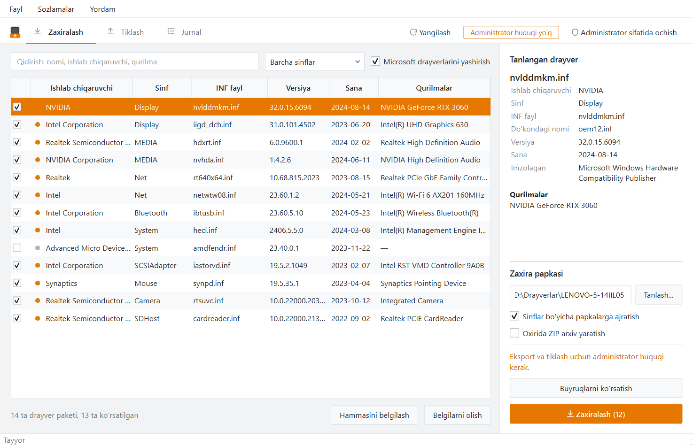
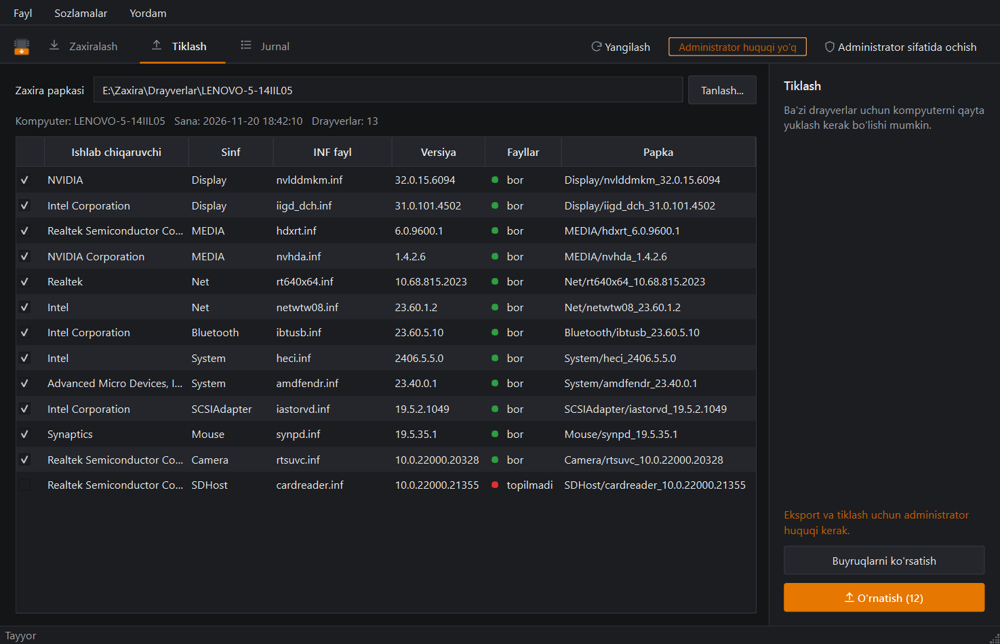

# Drayver zaxiralovchi: Uslubiy ko‘rsatma

Muallif: Hakimov Bahtiyorjon. Versiya: 1.0.2.

## 1. Uslubiy ko‘rsatmaning maqsadi va vazifalari

Ushbu uslubiy ko‘rsatma “Drayver zaxiralovchi” dasturidan oliy ta’lim muassasalari, kollej va texnikumlarda o‘quv mashg‘ulotlarida hamda tashkilotlarning texnik xizmat ko‘rsatish faoliyatida foydalanish tartibini belgilaydi.

Ko‘rsatmaning maqsadi talabalar va mutaxassislarda Windows operatsion tizimida drayverlarni boshqarish, ularni zaxiralash va tiklash bo‘yicha amaliy ko‘nikmalarni shakllantirishdir.

Vazifalar:

- drayver paketi, drayver ombori, INF fayl, qurilma sinfi tushunchalarini amaliy misolda tushuntirish;
- PnPUtil buyruq qatori vositasining asosiy buyruqlari bilan grafik interfeys orqali tanishtirish;
- operatsion tizimni qayta o‘rnatishga tayyorgarlik ko‘rish tartibini o‘rgatish;
- tizim darajasidagi amallarni administrator huquqi bilan, oldindan tekshirib bajarish madaniyatini shakllantirish;
- zaxira natijalarini manifest va jurnal yordamida hujjatlashtirish ko‘nikmasini rivojlantirish.
Ko‘rsatma o‘qituvchiga mashg‘ulotni rejalashtirish, topshiriqlarni tanlash va natijalarni baholash uchun tayyor tuzilmani beradi. Tashkilot mutaxassislari uchun esa u ish joyidagi kompyuterlarni qayta o‘rnatishga tayyorlashning bir xil tartibini joriy etishga yordam beradi. Dastur drayverlarni internetdan yuklamagani va faqat kompyuterda mavjud paketlar bilan ishlagani sababli mashg‘ulot internet ulanishi bo‘lmagan sinfxonada ham o‘tkazilishi mumkin.

## 2. Qo‘llash sohasi va maqsadli auditoriya

Dasturdan quyidagi fanlar va mutaxassisliklar bo‘yicha mashg‘ulotlarda foydalanish tavsiya etiladi: “Operatsion tizimlar”, “Kompyuter arxitekturasi”, “Kompyuter tizimlariga texnik xizmat ko‘rsatish”, “Axborot tizimlari ma’muriyati”, “Kompyuter tarmoqlari va qurilmalari”. Kollej va texnikumlarda kompyuter texnikasi operatori, kompyuter tizimlarini sozlovchi va ta’mirlovchi kasblari bo‘yicha amaliy mashg‘ulotlarda qo‘llash mumkin.

Maqsadli auditoriya: axborot texnologiyalari yo‘nalishidagi talabalar, kasb-hunar ta’limi o‘quvchilari, o‘qituvchilar, tashkilotlarning tizim ma’murlari va kompyuter servis markazlari xodimlari.

Kasbiy vazifalar: kompyuterni qayta o‘rnatishga tayyorlash, drayverlar inventarizatsiyasini o‘tkazish, bir xil modeldagi kompyuterlar uchun drayverlar to‘plamini tayyorlash, bajarilgan ishlar bo‘yicha hisobot (manifest va jurnal) saqlash.

Dasturdan foydalanishda o‘quvchilardan Windows operatsion tizimining asosiy tushunchalari (fayl tizimi, papkalar, foydalanuvchi hisoblari, Qurilmalar dispetcheri) bo‘yicha boshlang‘ich bilim talab qilinadi. Mashg‘ulotni Qurilmalar dispetcheri bilan bog‘lab o‘tkazish tavsiya etiladi: talabalar jadvaldagi qurilma nomlarini dispetcherdagi qurilmalar bilan solishtirib, drayver va qurilma o‘rtasidagi bog‘lanishni yaqqol ko‘radilar.

Tashkilotlarda dastur kompyuter parkini yangilash yoki operatsion tizimni ommaviy qayta o‘rnatish oldidan drayverlar zaxirasini tayyorlash bosqichida qo‘llanadi. Bir xil modeldagi kompyuterlar uchun bitta namunaviy zaxira tayyorlab, uni manifest bilan birga tashkilotning texnik arxivida saqlash mumkin. Bunda manifestdagi kompyuter nomi, Windows versiyasi va sana zaxiraning qaysi qurilmadan olinganini aniqlashga yordam beradi, “Jurnal” sahifasidan saqlangan matn fayli esa bajarilgan ish haqidagi hisobotga ilova qilinadi.

*1-rasm. Mashg‘ulotda o‘rganiladigan asosiy oyna: drayverlar jadvali va tanlangan drayver tafsilotlari*

## 3. O‘quv mashg‘ulotida foydalanish tartibi

Quyida 80 daqiqalik amaliy mashg‘ulot rejasi keltirilgan. Mashg‘ulot uchun har bir ish o‘rnida Windows 10 yoki 11 o‘rnatilgan kompyuter, dasturning .exe fayli va zaxira uchun fleshka yoki alohida papka tayyorlanadi. O‘quv kompyuterlarida administrator huquqi cheklangan bo‘lsa, eksport amalini o‘qituvchi kompyuterida namoyish qilish, talabalar esa ro‘yxat bilan ishlash va buyruqlarni ko‘rish qismini bajarishlari mumkin.

1. **Tashkiliy qism (5 daqiqa).** Davomatni aniqlash, mashg‘ulot mavzusi va maqsadini e’lon qilish, xavfsizlik qoidalarini eslatish: tiklash amali faqat o‘qituvchi ruxsati bilan bajariladi.
2. **Nazariy qism (20 daqiqa).** Drayver nima ekanligi, drayver paketi tarkibi (INF, katalog va ikkilik fayllar), drayver ombori, ombordagi oemNN.inf nomi va asl nom farqi, qurilma sinflari (Display, Net, MEDIA, System va boshqalar), raqamli imzo tushunchasi. PnPUtil vositasining “/enum-drivers”, “/export-driver” va “/add-driver ... /subdirs /install” buyruqlari vazifasi. Administrator huquqi va UAC mexanizmi.
3. **Amaliy qism (45 daqiqa).** Dasturni ishga tushirish va oyna bilan tanishish (5 daqiqa); drayverlar ro‘yxatini tahlil qilish, filtrlar va “Tanlangan drayver” paneli bilan ishlash (10 daqiqa); zaxiraga kiritiladigan drayverlarni tanlash va “Buyruqlarni ko‘rsatish” orqali buyruqlarni o‘rganish, .bat faylga saqlash (10 daqiqa); eksportni bajarish yoki o‘qituvchi namoyishini kuzatish, zaxira papkasi va manifest tuzilishini o‘rganish (12 daqiqa); “Tiklash” sahifasida zaxira papkasini ochib, “Fayllar” ustunini tahlil qilish va tiklash buyruqlarini ko‘rish (8 daqiqa).
4. **Yakuniy qism (10 daqiqa).** Natijalarni muhokama qilish, nazorat savollariga javoblar, mustaqil ish topshirig‘ini berish, baholash.
O‘qituvchi uchun tavsiyalar: mashg‘ulotdan oldin dasturni o‘z kompyuterida sinab ko‘ring va namoyish uchun kichik zaxira tayyorlab qo‘ying; talabalar o‘rtasida ishni juftlikda tashkil eting, biri amallarni bajarsin, ikkinchisi natijalarni hisobot jadvaliga yozsin; amaliy qism oxirida “Jurnal” sahifasini birgalikda tahlil qilib, qaytish kodlarining ma’nosini tushuntiring. Tiklash amalini haqiqiy o‘quv kompyuterida bajarish zarur bo‘lsa, buni faqat virtual mashinada yoki maxsus ajratilgan sinov kompyuterida o‘tkazing.

*2-rasm. Amaliy qismda ko‘rib chiqiladigan “Tiklash” sahifasi: manifest ma’lumoti va “Fayllar” ustuni*

## 4. Amaliy topshiriqlar

Topshiriqlar murakkablik darajasi bo‘yicha tartiblangan: dastlabki to‘rttasi oddiy foydalanuvchi huquqida bajariladi va tizimni o‘zgartirmaydi, 5-topshiriq faqat buyruqlarni ko‘rish va saqlashni talab qiladi, 6–8-topshiriqlar administrator huquqi va zaxira uchun tashuvchini talab qiladi. Har bir topshiriq natijasi talabaning hisobot daftarida yoki elektron hujjatda qayd etiladi.

1. **Drayverlar inventarizatsiyasi.** Dasturni ishga tushiring, “Microsoft drayverlarini yashirish” belgisini o‘chirib va yoqib, umumiy va ko‘rsatilgan paketlar sonini yozib oling. Kutilgan natija: jadval ostidagi satrdan olingan ikki son va ular orasidagi farqning izohi.
2. **Sinflar bo‘yicha tahlil.** Sinflar ro‘yxatidan navbat bilan Display, Net va MEDIA sinflarini tanlab, har bir sinfdagi paketlar va ular bog‘langan qurilmalarni jadvalga yozing. Kutilgan natija: sinf, ishlab chiqaruvchi, INF fayl, versiya va qurilma ko‘rsatilgan jadval.
3. **Ishlatilmayotgan drayverlarni aniqlash.** Kulrang nuqta bilan belgilangan yoki “Qurilmalar” ustunida chiziqcha turgan paketlarni toping va “Tanlangan drayver” panelida ularning ma’lumotlarini ko‘ring. Kutilgan natija: hozir hech bir qurilmada ishlatilmayotgan paketlar ro‘yxati va ularni zaxiralash kerakmi degan savolga asoslangan javob.
4. **Ombordagi nom va asl nom.** Uchta paket uchun “INF fayl” va “Do‘kondagi nomi” qiymatlarini solishtiring. Kutilgan natija: asl nom va oemNN.inf nomi farqini tushuntiruvchi qisqa izoh.
5. **Buyruqlarni oldindan ko‘rish.** Ikkita drayverni belgilab, “Buyruqlarni ko‘rsatish” oynasini oching, buyruqlarni .bat fayl sifatida saqlang va faylni matn muharririda oching. Kutilgan natija: .bat fayl tarkibidagi har bir qatorning vazifasi yozilgan izoh (kod sahifasi, papka yaratish, eksport buyrug‘i, pauza).
6. **Zaxira yaratish.** Administrator huquqi bilan tarmoq va tovush drayverlarini fleshkaga “Sinflar bo‘yicha papkalarga ajratish” va “Oxirida ZIP arxiv yaratish” belgilari yoqilgan holda eksport qiling. Kutilgan natija: sinf papkalari, manifest fayli va ZIP arxiv; yakuniy xabardagi muvaffaqiyatli va xato sonlari.
7. **Manifestni o‘rganish.** Yaratilgan manifest faylini matn muharririda oching va undagi kompyuter nomi, sana, Windows versiyasi va drayverlar sonini dastur xabari bilan solishtiring. Kutilgan natija: manifest maydonlari tavsifi.
8. **Tiklashga tayyorgarlik.** “Tiklash” sahifasida 6-topshiriqda yaratilgan papkani oching, “Fayllar” ustunini tekshiring va tiklash buyruqlarini “Buyruqlarni ko‘rsatish” orqali ko‘ring (o‘rnatishni bajarmasdan). Kutilgan natija: tiklash buyrug‘i tarkibi va “/subdirs”, “/install” kalitlari vazifasining izohi.
Qo‘shimcha murakkab topshiriq (ixtiyoriy, virtual mashinada): 6-topshiriqda yaratilgan zaxiradan bitta drayverni tiklab, “Jurnal” sahifasidagi natijani va yakuniy xabardagi sonlarni tahlil qiling. Kutilgan natija: tiklash buyrug‘ining chiqishi, qaytish kodi va qayta yuklash zarurati haqidagi xulosa.

## 5. Baholash mezonlari

Mashg‘ulot natijalari 100 ballik tizimda baholanadi:

- Nazariy tushunchalarni bilish (drayver paketi, ombor, INF fayl, qurilma sinfi, PnPUtil buyruqlari): 20 ball.
- Dastur interfeysida mustaqil ishlash, filtrlar va tafsilotlar panelidan to‘g‘ri foydalanish: 15 ball.
- Amaliy topshiriqlarning to‘liq va to‘g‘ri bajarilishi: 35 ball.
- Natijalarni hujjatlashtirish (jadvallar, .bat fayl izohi, manifest tavsifi, jurnal): 15 ball.
- Xavfsizlik qoidalariga rioya qilish (administrator huquqidan ongli foydalanish, tasdiqlashdan oldin tekshirish): 10 ball.
- Nazorat savollariga javoblar: 5 ball.
Amaliy topshiriqlar uchun ajratilgan 35 ball topshiriqlar soniga teng taqsimlanadi. Topshiriq to‘liq va xatosiz bajarilib, kutilgan natija hujjatlashtirilgan bo‘lsa, to‘liq ball qo‘yiladi; natija qisman olingan yoki izohsiz qoldirilgan bo‘lsa, ballning yarmi beriladi. Xavfsizlik qoidalari buzilgan holatda (masalan, ruxsatsiz tiklash bajarilsa) xavfsizlik mezoni bo‘yicha ball berilmaydi.

86–100 ball “a’lo”, 71–85 ball “yaxshi”, 56–70 ball “qoniqarli”, 55 ball va undan kam “qoniqarsiz” deb baholanadi.

## 6. Nazorat savollari

Quyidagi savollar mashg‘ulot yakunida og‘zaki so‘rov yoki yozma test shaklida qo‘llanadi. Javoblar nazariy qism materiallari va amaliy topshiriqlar natijalariga tayanishi lozim.

1. Drayver paketi qanday fayllardan iborat?
2. Drayver ombori nima va undagi oemNN.inf nomi asl INF nomidan nimasi bilan farq qiladi?
3. Nima uchun Microsoft drayverlarini zaxiralash odatda shart emas?
4. PnPUtil vositasining “/export-driver” va “/add-driver” buyruqlari qanday vazifani bajaradi?
5. “/subdirs” va “/install” kalitlari nimani anglatadi?
6. Nima uchun eksport va tiklash administrator huquqini talab qiladi?
7. Zaxira manifestida qanday ma’lumotlar saqlanadi va u nima uchun kerak?
8. Dastur manifest bo‘lmagan papkadan drayverlarni qanday aniqlaydi?
9. Zaxira papkasi sifatida disk ildizi tanlanganda dastur qanday yo‘l tutadi va nima uchun?
10. Tiklashdan keyin qurilma ishlamasa, qanday tekshiruvlarni bajarish kerak?

## 7. Mustaqil ish uchun tavsiyalar

Mustaqil ish mashg‘ulotda olingan ko‘nikmalarni mustahkamlash va ularni kasbiy vaziyatlarga tatbiq etishga qaratilgan. Ishlarni bajarishda dasturning foydalanish qo‘llanmasidan va PnPUtil bo‘yicha Microsoft rasmiy hujjatlaridan foydalanish tavsiya etiladi.

- Uy yoki o‘quv kompyuteringizdagi uchinchi tomon drayverlari ro‘yxatini tuzing va har bir qurilma sinfi bo‘yicha qisqa tavsif yozing.
- “Buyruqlarni ko‘rsatish” oynasidan olingan buyruqlarni PnPUtil rasmiy hujjatlaridagi sintaksis bilan solishtiring.
- Ikki xil sanada yaratilgan zaxira manifestlarini taqqoslab, qaysi drayverlar versiyasi o‘zgarganini aniqlang.
- Operatsion tizimni qayta o‘rnatishga tayyorgarlik bo‘yicha o‘z yo‘riqnomangizni tuzing: foydalanuvchi ma’lumotlari, drayverlar zaxirasi, o‘rnatish tashuvchisi, tiklash tartibi.
- Virtual mashinada xavfsiz sinov muhitini yaratib, tiklash amalini u yerda sinab ko‘ring.
- “Drayver paketlarini zaxiralash va tiklash” mavzusida 2–3 sahifalik referat tayyorlang, unda PnPUtil buyruqlari, manifest tuzilishi va xavfsizlik choralarini yoriting.
- Dasturning “Jurnal” sahifasidan saqlangan matn faylini tahlil qilib, har bir buyruqning natijasini o‘z so‘zlaringiz bilan izohlang.

## 8. Xavfsizlik va axborot madaniyati qoidalari

Dastur tizim darajasidagi amallarni bajaradi, shuning uchun u bilan ishlashda quyidagi qoidalarga qat’iy rioya qilinadi. Bu qoidalar o‘quv mashg‘ulotlari uchun ham, tashkilotdagi kundalik ish uchun ham amal qiladi.

- Tiklash amalini faqat o‘qituvchi yoki mas’ul mutaxassis ruxsati bilan bajaring; o‘quv kompyuterlarida tizim holatini o‘zgartirishdan oldin tasdiq oling.
- Administrator huquqidan faqat zarur amal uchun foydalaning va ishni tugatgach dasturni yoping.
- Har bir amaldan oldin tasdiqlash oynasidagi drayverlar soni va papka yo‘lini o‘qing, kerak bo‘lsa “Buyruqlarni ko‘rsatish” orqali buyruqlarni tekshiring.
- Faqat o‘zingiz yaratgan yoki ishonchli manbadan olingan zaxiradan drayver o‘rnating; noma’lum manbadagi INF paketlar tizim barqarorligi va xavfsizligiga zarar yetkazishi mumkin.
- Zaxira saqlangan fleshkani belgilab qo‘ying va boshqa kompyuter zaxiralari bilan aralashtirmang; dastur har bir kompyuter uchun alohida papka yaratadi.
- Jurnal va manifestni bajarilgan ish hisoboti sifatida saqlang.
- Dasturni faqat muallifning rasmiy GitHub sahifasidan yuklab oling.
- Zaxira papkasida boshqa shaxslarning ma’lumotlari bo‘lmasligi kerak; manifest faqat kompyuter nomi va drayverlar ma’lumotini o‘z ichiga oladi, uni tashqi shaxslarga berishda shuni hisobga oling.
